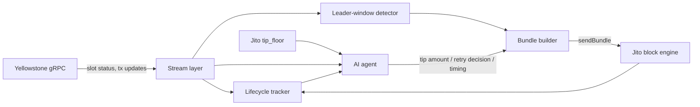

# Architecture — Reflex

> Publish this to Notion / Google Docs / Figma (a public URL) and link it in your
> submission. It is judged separately, so depth and clear diagrams matter. Fill each
> section; the prompts below are scaffolding, not final copy.

## 1. System architecture

Describe the three layers and why they are separated:
- **Stream layer** — Yellowstone gRPC ingestion (slots + own-account transactions).
- **Core transaction stack** — leader detection, bundle build/submit, lifecycle tracking, failure classification.
- **AI layer** — consumes observations, emits one structured operational decision.

Suggested diagram (replace with a real one):

## 2. Key components

For each: input, output, failure modes.
- Yellowstone subscriber (commitment levels used, filters, ping handling)
- Leader-window detector (`getNextScheduledLeader`, regions)
- Tip intelligence (tip_floor percentiles, EMA, min-tip floor)
- Bundle builder (tx + tip transfer as final instruction, ≤5 tx, atomicity)
- Lifecycle tracker (timestamps, slots, latency deltas per commitment stage)
- Failure classifier (expired blockhash / fee too low / compute exceeded / bundle failure)
- AI agent (the one decision it owns, and its guardrails)

## 3. Data flow between services

Walk a single transaction end to end: blockhash fetch (which commitment, and why) →
bundle assembly → submit → stream observes processed → confirmed → finalized →
deltas recorded → on failure, classify → agent reasons → resubmit.

## 4. Infrastructure decisions

- Why Yellowstone gRPC over RPC websockets/polling for confirmation.
- Provider choice and region (latency to block engine region).
- Commitment level per use (blockhash = confirmed; landing detection = slot status stream).
- Mainnet (Jito has no devnet); tiny self-transfer/memo txs with minimum-ish tips.

## 5. Failure handling strategy

- Stream reconnect + backpressure (bounded queue, drop policy, replay on reconnect).
- Blockhash-expiry detection and refresh.
- Retry policy and how it avoids infinite loops / double-spends.
- What is logged on every failure for the lifecycle log.

## 6. AI agent responsibilities

- The single operational decision it owns: **autonomous retry with fault injection**.
- Inputs (failure classification, slot conditions, live tip floor) and the structured
  output (refresh blockhash? recalc tip to what? resubmit when?).
- How its reasoning is made visible (logged rationale per decision).
- Guardrails: bounded retries, cost ceiling, what it is *not* allowed to decide.
- Why this is genuine reasoning, not sequential automation.
